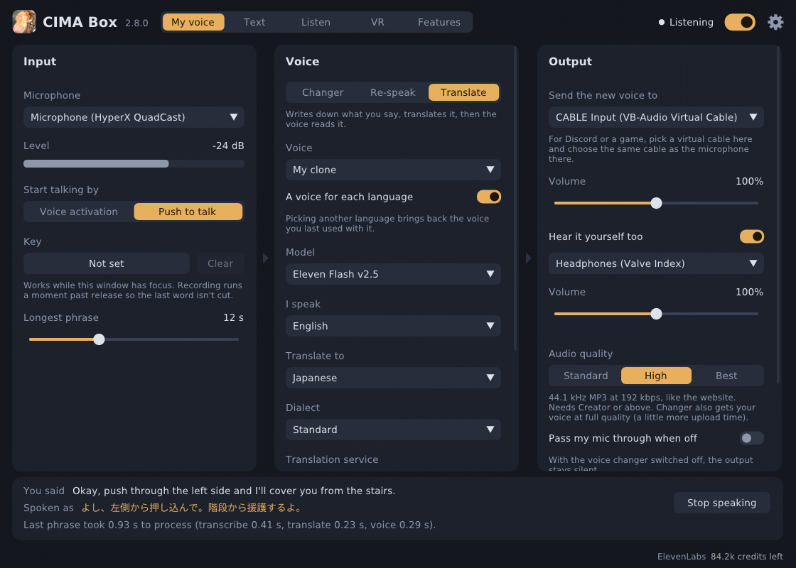
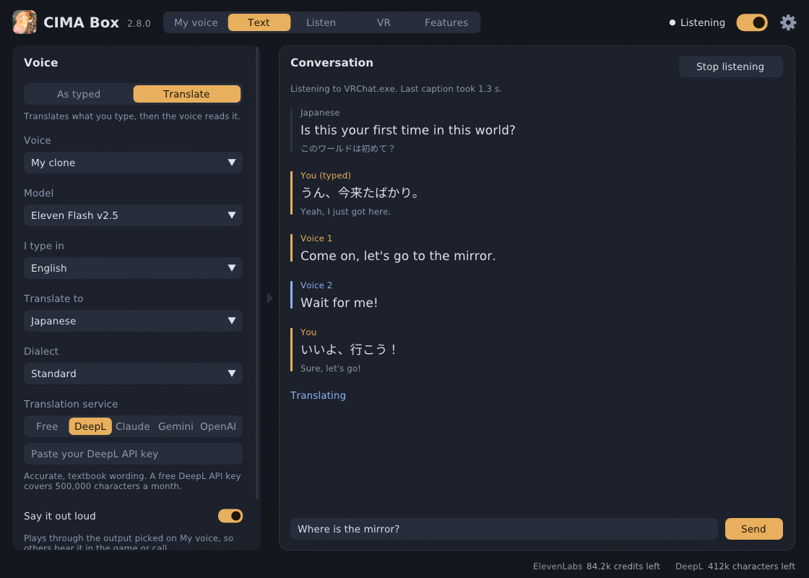
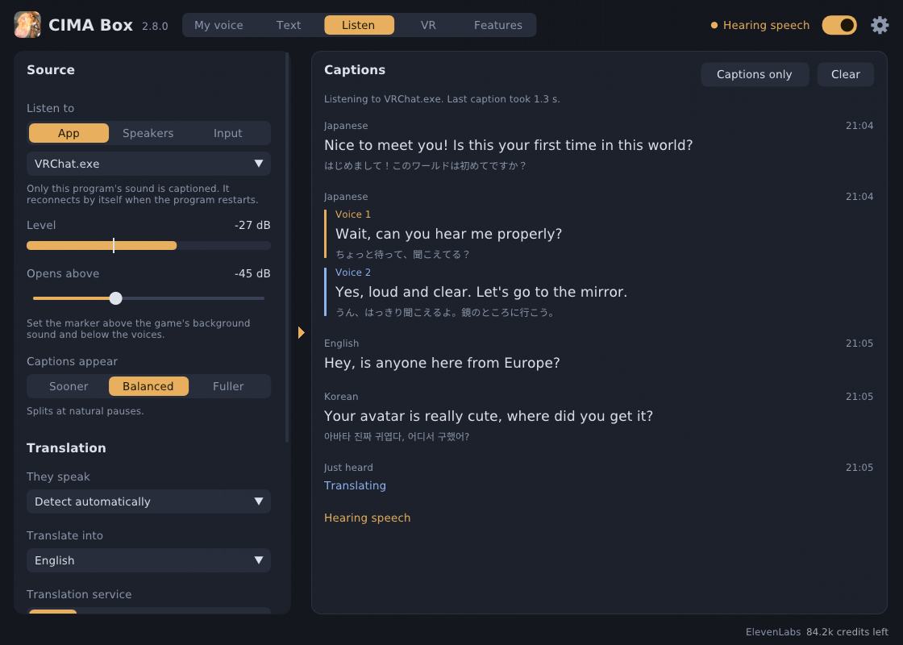
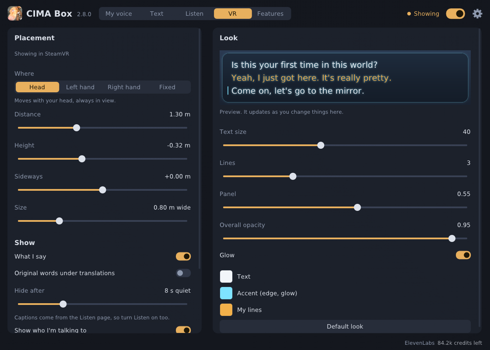
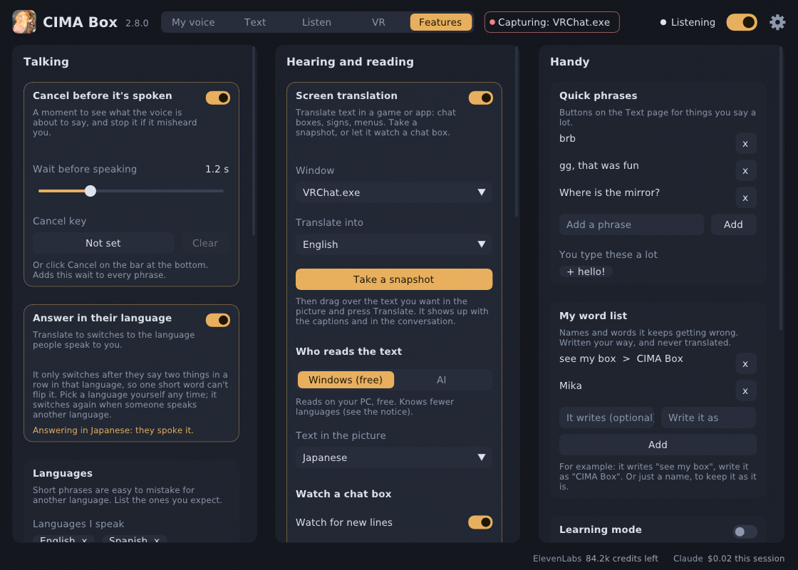
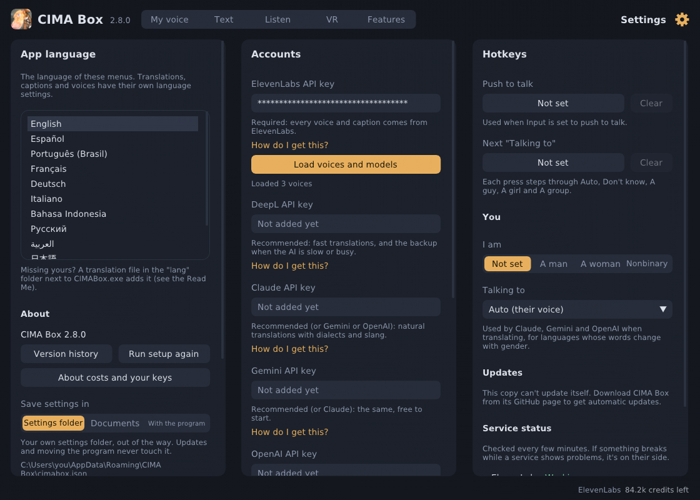

# CIMA Box

Change your voice, speak other languages like a native, and read what everyone around you is saying,
live, in any game or voice chat: Discord, VRChat, Valorant, Fortnite, Rec Room, you name it.
Powered by ElevenLabs.

**[Download CIMA Box for Windows](https://github.com/Aye7even/CIMA-Box/releases/latest/download/CIMABox.exe)**

That one file is the whole program. Put `CIMABox.exe` in a normal folder (like Documents or
Desktop) and run it. It updates itself from then on, and tells you what's new after each update.

## What it does

**My voice**: your microphone, turned into any ElevenLabs voice (including a clone of your own).
- **Changer** keeps your own timing and emotion. The fastest and most natural mode.
- **Re-speak** has the voice say your words in its own delivery.
- **Translate** speaks your words in another language: 91 of them.
- With Claude, Gemini or OpenAI, translations sound like a real person talking, not a textbook: casual
  speech, slang and **dialects** (Mexican or Puerto Rican Spanish, Kuwaiti or Egyptian Arabic,
  Kansai Japanese, Swiss German, Hinglish and many more), and the right words for **who's speaking
  and who you're talking to** in languages that change with gender.
- **Carry my emotion** passes on how you said it: the words you stressed, pauses, laughs, whispers.
- Works anywhere that takes a microphone: games, Discord, Zoom, OBS and streams.
- In VRChat it can also show what you said, or the translation, in the chatbox above your avatar.

**Text**: type instead of talking. The voice reads what you type, as typed or translated into
another language, and it can go in the VRChat chatbox too. What other people say (from Listen)
shows up translated in the same window, so you can follow the whole conversation without switching
tabs. Handy when you can't or don't want to talk out loud.

**Listen**: live captions of what other people say, translated into your language. It can listen to
just one program (your game, Discord...), everything on your speakers, or a microphone, and tells
apart who is speaking. Keep the captions in a small window on top of your game.

**VR**: those captions on a small see-through panel inside your headset, in any SteamVR game. Put it
in front of your eyes, on your wrist, or in a fixed spot. Switch who you're talking to from the
SteamVR menu without taking the headset off.

**Features**: extras you turn on one at a time, so the app stays simple if you don't need them.
- **Screen translation**: pick a window, take a snapshot, drag over the text and press Translate.
  Or let it watch a chat box and translate new lines by itself. Reads on your PC for free, or with
  AI for any language.
- **Hear them in your ear**: a voice reads the translated captions in your headphones.
- **Captions while they talk**, **answer in their language**, a **see-through caption window**
  that clicks pass through, sound labels, high-contrast captions and muting one person.
- **Cancel before it's spoken**, **clean up your swearing** (tone down or bleep), **Best
  translations**, and **Try a line** to compare styles.
- **Quick phrases**, **your own word list**, **learning mode** (how to read a line, replay, save),
  a searchable **history**, and **profiles** you can share with friends as a code (never with keys).

The app itself speaks English, Español, Português, Français, Deutsch, Italiano, Bahasa Indonesia,
Русский, العربية, 日本語, 한국어 and 简体中文 (Settings, the gear at the top right). Arabic, Persian, Urdu
and Hebrew are shown right to left with joined letters, in the app and in VR.

## What you need

- **Windows 10 or 11.**
- **An [ElevenLabs](https://elevenlabs.io) account and API key.** CIMA Box uses your own account,
  so you pay ElevenLabs directly for what you use. Higher plans unlock better audio quality.
- **A virtual audio cable** so games and apps can hear the new voice, for example the free
  [VB-Audio Virtual Cable](https://vb-audio.com/Cable/).
- Optional, for natural translation: a [Claude](https://console.anthropic.com),
  [Gemini](https://aistudio.google.com) or [OpenAI](https://platform.openai.com) API key (a
  fraction of a cent per sentence), or [DeepL](https://www.deepl.com/pro-api).
- For VR captions: SteamVR.

## Getting started

1. Run `CIMABox.exe`. Click the **gear** (top right), paste your ElevenLabs API key under
   **Accounts** and click **Load voices and models**.
2. On **My voice**, pick your microphone (Input), a voice (Voice), and where the new voice goes
   (Output): choose **CABLE Input** there.
3. In your game, Discord or any other app, choose **CABLE Output** as your microphone.
4. Flip the switch at the top right and talk.

To read what others say, open **Listen**, pick your game (or Discord, or any program) and the
language to translate into, and switch it on. Playing in VR? Turn on **VR** too, for captions inside
your headset.

Every button and setting is explained in **[`CIMA Box - Read Me.txt`](CIMA%20Box%20-%20Read%20Me.txt)**.

## Good to know

- **Put the program anywhere**, Desktop included. Settings save by themselves, and you choose
  where (Settings > About > Save settings in): your settings folder (the default), a
  `CIMA Box Config` folder in Documents, or right next to `CIMABox.exe` to keep everything in one
  folder.
- **Your keys stay on your PC.** They're saved in that settings file (`cimabox.json`) and only ever
  sent to the services they belong to. Don't share that file.
- **What's sent where:** your voice goes to ElevenLabs; text to translate goes to the translation
  service you picked. With Listen on, other people's voices are sent to ElevenLabs too, to caption
  them. Captions are never saved, unless you turn on Keep a history (a text file on your PC).
  Screen translation only captures the window you pick, when you ask; with AI reading that picture
  goes to the AI service, so never capture anything private.
- **Updates** are checked when the app starts and install with one click (Settings > Updates). Each
  one is signed, and the app refuses anything that isn't.
- **Your browser or Windows SmartScreen** may warn about the download or the first run ("Windows
  protected your PC"), because the program is new and not from a big company. In the browser choose
  **Keep**; in SmartScreen click **More info** > **Run anyway**.
- Keep CIMA Box in a folder you can write to (not Program Files) so it can update itself.
- **First time?** A short setup walks you through everything, starting with your language. Run it
  again from Settings > About.
- **Your keys, your costs.** CIMA Box is free and runs on your own accounts, so whatever it uses is
  charged to your keys. Switch off what you aren't using, set a spending limit (Settings >
  Accounts), and remember that friends using your key count on your account. The author isn't
  responsible for charges or used-up credits: you use it at your own risk.
- **What's left** of your ElevenLabs credits (and DeepL characters, or what Claude, Gemini or OpenAI cost
  this session) shows quietly at the bottom of the window.
- **Something stopped working?** Settings > Service status shows whether ElevenLabs, Claude,
  OpenAI or DeepL are having problems right now, and a small note appears at the top of the window when a
  service you use is. Then it's on their side: wait a bit and try again. Settings > About > Open
  log file shows what went wrong (it never contains your keys), so you can send it to whoever helps
  you.
- What changed in each version: [CHANGELOG.md](CHANGELOG.md).

## Credits

A lot of this program was built with the help of Claude Fable and Claude Opus by Anthropic, so
shout out to them.

Building it yourself or publishing releases: see [DEVELOPING.md](DEVELOPING.md).
